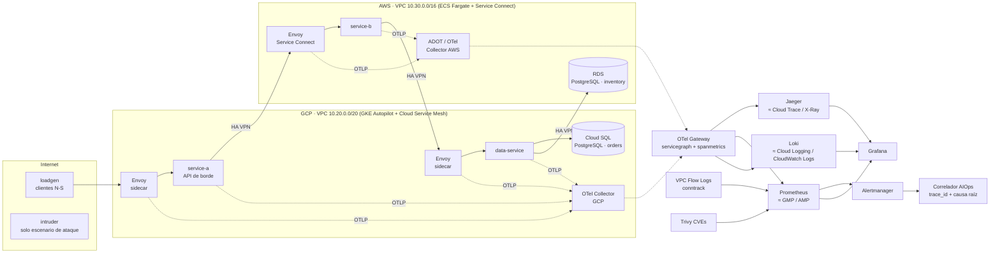

# LAB integrador: observabilidad end-to-end con AIOps y resiliencia (GCP + AWS)

Observabilidad en Ambientes Productivos · Universidad de La Sabana · v1.0

Este laboratorio extiende los anteriores (2.2) a un sistema observable de nivel productivo. Tiene **tres microservicios instrumentados con OpenTelemetry** (trazas, métricas y logs), un **service mesh L7**, dos bases de datos gestionadas (Cloud SQL y RDS), **detección de anomalías con AIOps**, **observabilidad de red y seguridad** y **experimentos de caos controlados**.

> **Modo de ejecución.** El equipo no contaba con cuentas de GCP ni de AWS. Por eso toda la solución se ejecutó en un *sandbox* de "producción simulada" (Docker Compose) que reproduce la topología multi-nube. El IaC de Terraform para ambas nubes está completo y **validado** (`terraform validate`), pero no se aplicó. La tabla de equivalencias muestra qué componente del sandbox reemplaza a cada servicio gestionado. Esto cumple además la recomendación de ejecutar el caos solo en sandbox.

## Arquitectura



| Pieza | Sandbox (ejecutado) | GCP (IaC `infra/gcp`) | AWS (IaC `infra/aws`) |
|---|---|---|---|
| Cómputo | contenedores | GKE Autopilot (`infra/k8s`) | ECS Fargate |
| Service mesh L7 | Envoy 1.33 como sidecar (métricas L7, trazas, access logs OTel, fault injection) | Cloud Service Mesh gestionado | ECS Service Connect (App Mesh llegó a fin de soporte el 30-sep-2026) |
| Base de datos | PostgreSQL 16 ×2 | Cloud SQL PG16 + Query Insights | RDS PG16 + Performance Insights |
| Trazas | Jaeger v2 | Cloud Trace | X-Ray (ADOT) |
| Métricas y reglas | Prometheus 3.5 + Alertmanager | Managed Service for Prometheus + reglas GMP + políticas PromQL | CloudWatch + Anomaly Detection + alarma compuesta |
| Logs | Loki 3.4 (OTLP) | Cloud Logging + métricas basadas en logs | CloudWatch Logs + metric filters |
| Flow logs | conntrack → formato VPC Flow Logs v5 (AWS) y `vpc_flows` (GCP) | VPC Flow Logs (5 s, 50 %) + firewall logging | VPC Flow Logs v5 → CloudWatch |
| Seguridad | Trivy + alertas + hallazgos con formato OCSF | Security Command Center (notificaciones a Pub/Sub) | Security Hub CSPM + GuardDuty + Inspector |
| AIOps | reglas ±2σ + correlador | alertas PromQL sobre series grabadas + forecast | ANOMALY_DETECTION_BAND + alarma compuesta (DevOps Guru no admite clientes nuevos desde el 29-oct-2026) |
| Caos | Envoy runtime + `/admin/chaos` | VirtualService `fault` (Cloud Service Mesh) | AWS FIS `aws:ecs:task-network-latency` con *stop condition* |

## Estructura

```
services/            3 microservicios FastAPI + telemetry.py común (OTel SDK, DB semconv estables)
mesh/                sidecars Envoy (generados por render_envoy.py)
otel/                collectors GCP, AWS y gateway (servicegraph, spanmetrics)
observability/       Prometheus (reglas SLI, baseline ±2σ, estáticas, AIOps, seguridad), Alertmanager, Loki, Jaeger, Grafana
aiops/correlator/    correlador: trace_id del request fallido, causa raíz, servicegraph, incidentes, hallazgos
network/flowlogs/    emulador de VPC Flow Logs (N-S / E-W / entre nubes, REJECT, flujos no permitidos)
security/scanner/    exportador de CVEs (Trivy)
chaos/               run_experiments.py (E1/E2 con guardrails) e intruder.py (escenario de seguridad)
infra/gcp|aws|k8s    IaC Terraform + manifiestos GKE (reglas GMP, collector, fault injection)
scripts/             run_lab.sh (ejecución completa), analyze.py (MTTD/SLO/error budget/figuras), cve_scan.sh
docs/                arquitectura, runbook, decisiones, madurez, guion de video y evidencias/
```

## Cómo ejecutarlo

Requisitos: Docker Desktop (o Docker Engine) con Compose v2, unos 6 GB de RAM y Python 3.10+ con `matplotlib`. En Windows usa WSL2. Los flow logs leen `nf_conntrack` del kernel Linux.

```bash
./scripts/run_lab.sh          # ≈ 95 min: línea base (35) + ventana de ruido (20) + E1 (5+10) + E2 (5+10) + ataque
```

Para la demo en vivo (versión corta), levanta el stack y dispara los experimentos a mano:

```bash
docker compose up -d                       # Grafana http://localhost:3000 · Jaeger :16686 · Prometheus :9090
docker compose --profile chaos run --rm -e BASELINE_MIN=8 -e NOISE_MIN=2 -e RECOVERY_MIN=4 chaos-runner
docker compose --profile attack run --rm intruder
python3 scripts/analyze.py
```

## Resultados

Ver `docs/evidencias/resultados.json` y el reporte ejecutivo (PDF). Ahí están el MTTD de cada experimento, el consumo de error budget, la reducción de alertas ruidosas frente a los umbrales estáticos y los hallazgos de seguridad.

## Validación (CI)

`.github/workflows/ci.yml` ejecuta `terraform fmt/validate` (GCP y AWS), `promtool check rules`, `amtool check-config`, la validación de Envoy y de los collectors OTel, el build de las imágenes y el escaneo con Trivy.
